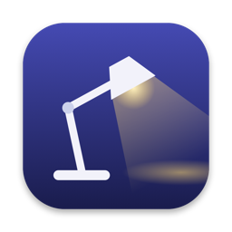
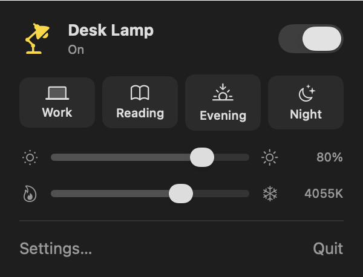

<p align="center"></p>

# NordvaDeskLamp

**Control your Xiaomi desk lamp from the Mac menu bar, without the Xiaomi Home app.**

NordvaDeskLamp is a tiny, free menu bar app for macOS. Click the lamp icon and you get a
switch, a brightness slider and a warm-to-cool color temperature slider. It talks to the
lamp directly over your home Wi-Fi: no cloud, no phone, instant response. Turn the lamp on
with its own button and the panel follows within a second; the menu bar icon is filled while
the lamp is on.

<p align="center"></p>

Tested with the **Mi LED Desk Lamp Pro (MJTD02YL)**. Other Xiaomi lamps made by Yeelight
that speak the same local protocol will likely work too.

## Install

Works on macOS 13 Ventura or later, Apple Silicon or Intel.

1. **Download** `NordvaDeskLamp.zip` from the [latest release](https://github.com/orhan17/NordvaDeskLamp/releases/latest),
   unzip it and **drag `NordvaDeskLamp.app` into Applications**.
2. **Open it.** The first time, macOS says it could not verify the app: it is free and not
   registered with Apple. Click **Done**, then go to **System Settings → Privacy & Security**,
   scroll down and click **Open Anyway**. This is needed only once.
3. **Get the lamp's token** (a one-time step, see below) and add it to the Keychain.
4. **Click the lamp icon** in the menu bar → **Settings…**, enter the lamp's address and click
   **Connect**. Allow access to the local network and to the Keychain item when macOS asks.

### The lamp's token

Xiaomi lamps only accept commands encrypted with a per-device key called the token. You get
it once from your Xiaomi account with the open-source
[Xiaomi Cloud Tokens Extractor](https://github.com/PiotrMachowski/Xiaomi-cloud-tokens-extractor).
This keeps everything in a throwaway folder:

```bash
mkdir -p ~/xiaomi-token && cd ~/xiaomi-token && curl -fL -o token_extractor.zip https://github.com/PiotrMachowski/Xiaomi-cloud-tokens-extractor/releases/latest/download/token_extractor.zip && unzip -o token_extractor.zip && cd token_extractor && python3 -m venv .venv && .venv/bin/pip install -r requirements.txt && .venv/bin/python token_extractor.py
```

Sign in with the QR code, find your lamp in the list and copy its **TOKEN** (32 hex characters)
and **IP**. Then store the token in the Keychain; the command asks for it twice and does not
show what you type:

```bash
security add-generic-password -U -s io.github.orhan17.NordvaDeskLamp -a token -w
```

Afterwards you can delete the extractor: `rm -rf ~/xiaomi-token`.

For the address you can use the IP from the list, or the lamp's network name such as
`MiDeskLampPro-XXXX.local`, which keeps working if your router gives the lamp a new IP.

## Build from source

Only the Command Line Tools are required (`xcode-select --install`).

```bash
git clone https://github.com/orhan17/NordvaDeskLamp.git
cd NordvaDeskLamp
./build.sh --install   # build, copy to /Applications and launch
```

Other commands:

```bash
./build.sh         # build build/NordvaDeskLamp.app
./build.sh --zip   # universal build packed into build/NordvaDeskLamp.zip for a release
./test.sh          # protocol tests
swift scripts/make-icon.swift   # regenerate the icon
```

Debug flags (run the app with `open -n /Applications/NordvaDeskLamp.app --args <flag>`, so
macOS applies the app's own local network permission):

| Flag | What it does |
|------|--------------|
| `--check` | connects, prints the lamp's state and quits |
| `--debug` | logs every command and reply |
| `--panel-snapshot <path>` | renders the panel to a PNG |

## How it works

Xiaomi's local **miIO** protocol runs over UDP port 54321. A 32-byte header carries the device
id, a timestamp and an MD5 checksum; the JSON command after it is encrypted with AES-128-CBC,
where the key is MD5 of the token and the IV is MD5 of the key and the token. A "hello" packet
first gets the lamp's id and clock. Commands are `get_prop`, `set_power`, `set_bright` and
`set_ct_abx`.

| File | Role |
|------|------|
| `Sources/NordvaDeskLampCore/MiioCodec.swift` | packet encryption and checksums, tested against OpenSSL |
| `Sources/NordvaDeskLampCore/LampState.swift` | parses the lamp's state |
| `Sources/NordvaDeskLamp/MiioClient.swift` | the UDP handshake and request/reply |
| `Sources/NordvaDeskLamp/Lamp.swift` | lamp state for the panel; sends only the latest slider value |
| `Sources/NordvaDeskLamp/LampPanel.swift` | the SwiftUI panel |
| `Sources/NordvaDeskLamp/LampToken.swift` | reads the token from the Keychain |

## Pitfalls

- **The token stays out of the app's files.** It is a key to the lamp, so it lives only in the
  Keychain, never in preferences or code.
- **Local network permission.** macOS blocks apps from talking to devices on your network until
  you allow it. A denied permission shows up as "no route to host", which the app turns into a
  readable message.
- **The lamp never reports changes on its own.** The local protocol has no notifications, so
  the app asks for the state every second while the panel is open and every 10 seconds
  otherwise. Readings that arrive within 1.5 s of your own change are ignored, or a reading
  taken before your change reached the lamp would snap the slider back.
- **Slider drags would flood the lamp.** Every slider tick would be a network request, so only
  the latest value per command is sent, at most about every 150 ms.
- **An ad-hoc signature loses permissions on every rebuild.** `build.sh` pins the signature's
  requirement to the bundle id, so local network and Keychain access survive updates.

## License

MIT, see [LICENSE](LICENSE). Not affiliated with Xiaomi or Yeelight.
